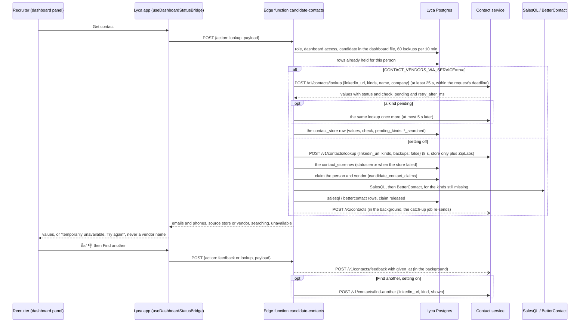

# Contact reveal (Lyca)

How Lyca finds a candidate's email and phone, what it keeps, and how it stays in step with the shared contact store. Lyca only: Adobe's project shares the code but has none of these tables or settings.

The code is in `supabase/functions/candidate-contacts/`, with the flow decisions in `flow.ts`. The catch-up job is `supabase/functions/contact-store-sync/`.

## What is live and what is in review (3 Nov 2026)

| State | What |
| --- | --- |
| **Live on Lyca production** (`main`, PRs #39/#40 and #43/#44) | "Get contact" asks the store (3 s, no `ziplabs: false`), then SalesQL, then BetterContact, both automatic; the vendors' answers and every 👍/👎 go to the store in the background; Find another after a 👎 goes to the next vendor not yet asked |
| **In review** | #46 (HIR-526): `store_synced_at` and the catch-up job. #47 (HIR-528): claims, one phone format, an 8 s store wait, `pending`, outages shown as such. #48 (HIR-537): `CONTACT_VENDORS_VIA_SERVICE`. This document describes the three together |
| **Not built** | Showing the service's email `check` in the panel (it is stored only) |

Whether the store's secrets are set on the Lyca project, and whether the catch-up job is scheduled, cannot be seen from the repo.

## The flow at a glance



## The reveal

**Who can do what:**
- "Get contact" and "Find another" are open to every role: Viewer, Admin and Super Admin (product owner, 4 Nov 2026; until then Admins and Super Admins only). They can spend vendor credits, so the limits below apply to everyone. "Find another" runs only when someone clicks it after a 👎, never on its own.
- Anyone who can see a dashboard can read its contacts and give a 👍/👎.

**A lookup only runs for a LinkedIn profile in that dashboard's own file.** Each person is limited to 60 vendor calls per 10 minutes.

"Get contact" asks, in this order, and stops at the first source that has a value for each kind (email, phone):

1. **Lyca's own rows.** A person looked up before is never bought again. Only kinds that still have no usable value are searched again: first in the store if it was never really asked for this person (it was down at the time, or the lookup predates it), then with a vendor that never answered for that kind.
2. **The shared contact store** at `CONTACT_ENRICHMENT_URL` (the contact-enrichment service). It holds what any HireSense platform has already revealed. If it has nothing usable, it asks ZipLabs on demand.
   - Lyca waits up to `CONTACT_ENRICHMENT_TIMEOUT_MS` (8 s by default), because a first ZipLabs answer takes several seconds.
   - **Still fetching.** The store may answer `pending` for a kind (ZipLabs is still fetching it) with `retry_after_ms`. Lyca then pays no vendor for that kind yet: it waits that long (at most 5 s), asks the store once more, and only what is still missing then goes to the vendors.
   - If the store is down, slow or answers with an error, Lyca goes on to its vendors. That is recorded (a `contact_store` row with status `error`), so a later "Get contact" asks the store again.
3. **SalesQL**, automatically, for each kind the store did not have.
4. **BetterContact**, automatically, for each kind SalesQL did not find.
   - BetterContact answers later. The panel checks back (a free status check, never a new charge).

**A vendor value its own vendor calls bad does not count as found.** That means a SalesQL email with status "Invalid", or a phone with `is_valid: false`. BetterContact is asked for that kind. Such a value is shown, marked "invalid by the source", only while nothing better exists. It is never sent to the shared store (other products would read it as an ordinary contact).

**One paid call per person and vendor at a time.** Two recruiters, two tabs or a double click on the same person pay SalesQL once and BetterContact once:
- Before paying, the request claims the person and vendor in `candidate_contact_claims`, with an insert that does nothing if the row exists.
- The request that gets the row reads the saved answer again (someone may have just paid), pays, saves the answer, then deletes the row. While it runs it refreshes the row's `claimed_at` every 30 s, so a slow call is never mistaken for a dead one.
- The others wait (up to 30 s, less if the request's time is nearly up) and show the saved answer.
- A claim not refreshed for 3 minutes was left by a request that died, and is taken over. Each claim query gives up after 5 s.

**A paid answer is never silently lost.** If saving it fails, the save is retried once with the same answer. If that fails too, the answer is lost: the log says so as an error, with counts only (status, number of emails and phones). The claim is then kept, not deleted, so nobody pays that vendor again for that person for 3 minutes; the request answers "temporarily unavailable".

**A SalesQL call that timed out (20 s) may have been charged,** so it is not repeated for 3 minutes. A call that never reached SalesQL is retried on the next click.

**One deadline per request (about 55 s).** The store's answer, its `pending` wait and the waits for another request's claim each get only what is left. A paid call (SalesQL, or starting a BetterContact search) starts only with at least 25 s left, enough to finish and save it; otherwise it is left for the next click ("Try again" / "Find email"), never paid and then cut off. BetterContact's own wait for its answer is cut to what is left; a search still running is saved as pending and checked later for free.

**Outage is not "no contact".** If the store or a vendor failed and nothing usable came back, the panel says the lookup is temporarily unavailable and offers "Try again". It never shows a final "No email found" in that case. An unexpected failure answers the same generic "temporarily unavailable" text; the database's or vendor's own message stays in the function log.

**A rate-limited store is not an outage.** When the contact service answers 429 `rate_limited` (Lyca sent too many requests that minute, contact-enrichment #20), Lyca does not fall back to its own SalesQL / BetterContact, which a store outage (5xx, timeout, no connection) still does: that would turn hitting the limit into more vendor spend. "Get contact" records it like an outage (the `contact_store` row gets status `error`, nothing is saved as "not found"), so the panel says "temporarily unavailable" and the next "Get contact" asks the store again; "Find another" answers 503 "temporarily unavailable". The same holds when only the second ask after `pending` is rate limited. The log gets a warning with the status and the `Retry-After` value.

Known gaps: a store outage, once recorded, keeps showing "temporarily unavailable" until someone clicks "Try again" (the list never calls the store). A BetterContact error that needs an admin (no credits, key rejected, phone search not in the plan) also shows "Try again" until that is fixed.

The dashboard only ever sees "Email" and "Phone", plus whether a value came from the store or from Lyca's own vendors. It is never told which vendor.

## 👍/👎 and "Find another"

**👍/👎 is offered on:**
- store values;
- SalesQL values, until BetterContact has been asked for that kind.

It is never offered on BetterContact values, because there is no vendor left to ask after them.

Clicking the same thumb again clears it **in Lyca only**. The shared store has no way to clear a verdict (its API takes only 👍 or 👎), so a 👍/👎 that already reached the store stays there: a 👎 that is undone still marks the value bad for every other product. Only a new verdict on the same value replaces it. A 👍/👎 cleared before it reached the store (store down) is never sent, because clearing deletes Lyca's row.

**"Find another email / number" is offered:**
- after a 👎 on a store value: the next vendor not yet asked for that kind (SalesQL, else BetterContact);
- after a 👎 on a SalesQL value: BetterContact, if not yet asked for that kind;
- as "Find email / number" for a kind with no value that a vendor never answered for, or that the store was never really asked for.

It is never offered after BetterContact. Each kind is bought from each vendor at most once per person.

"Find another", and resuming a person looked up before, **ask the store first** for the kinds wanted. A value the store has that is new for this person (not shown yet, not marked 👎) answers that kind without a paid vendor.

**One phone format for every comparison.** The rule is in `phone.ts`, exactly contact-enrichment's `docs/PHONE.md` (HireTap uses the same rule):
- India (+91) is the default country.
- `+91 98765 43210`, `098765 43210` and `9876543210` are one number.
- A result starting `+0` is not a phone, and a `+91` number is a phone only with 12 digits in all.
- **A value the rule refuses is not a phone at all** (for example SalesQL's `12345`, even with `is_valid: true`). It is not kept, not shown and not counted as found, so BetterContact is asked for a phone.

The comparisons that use it: de-duplication, "is this marked 👎", "is this new" for Find another, and which row a 👍/👎 belongs to. Rows keep the vendor's own text; only the comparisons use the shared format.

## Through the contact service (HIR-537)

Decision [HIR-461](https://linear.app/hiresenseai/issue/HIR-461): the shared contact service makes every contact vendor call. Lyca moves onto it behind one setting, `CONTACT_VENDORS_VIA_SERVICE` (a function secret on the Lyca project).

- **Off** (unset, the default, or anything but `true`): exactly the reveal above. Lyca asks the store, then calls SalesQL and BetterContact itself. That store lookup sends `backups: false`: a service that lists `lyca` in its `WATERFALLS` (while switching on or back) then asks only the store and ZipLabs, never its own backup vendors, so a reveal never pays SalesQL or BetterContact twice. A service from before `backups` (contact-enrichment HIR-142, no `WATERFALLS` either) refuses the field with 422 `property backups should not exist`; Lyca then asks once more without it and leaves it out for 10 minutes.
- **On** (`true`): Lyca calls no vendor itself. The code is `supabase/functions/candidate-contacts/via-service.ts`.

Lyca's vendor code stays, because switching back needs it. Turning the setting on or off is a secret change, not a code deploy.

**With the setting on:**

1. **"Get contact" is one `POST /v1/contacts/lookup`.**
   - It is sent without `ziplabs: false`, so the service runs Lyca's order from its `WATERFALLS`: the store, then SalesQL, BetterContact, ContactOut, and ZipLabs last (order set 4 Nov 2026). ContactOut is asked only through the service; with the setting off, Lyca calls SalesQL and BetterContact itself and never ContactOut.
   - It carries the candidate's `name` and `company` (what Lyca sends BetterContact today; left out when empty, cut to the service's 200 characters). The service gives them to BetterContact only and never stores them. Find another sends them too.
   - **Before and after contact-enrichment #19.** Only #19 adds `name` / `company` to the service, and the service refuses unknown fields (422 `property name should not exist`). On exactly that 422, Lyca asks once more without them, and leaves them out for the next 10 minutes before trying again (logged as a warning). So Lyca works against the service before #19 (BetterContact inside the service then searches without name and company) and after it. Any other 4xx except 409 / 429 is logged as an error: a retry never fixes it.
   - Lyca waits `CONTACT_ENRICHMENT_TIMEOUT_MS`, but never less than 25 s: each vendor in the order can take its own timeout, and the service's own worst case is about 22 s. Every call, and the `pending` wait, is also cut to what is left of the request's deadline (about 55 s, `deadline.ts`): a call with no time left is not made and counts as an outage.
   - A kind in `pending` is waited for (`retry_after_ms`, at most 5 s) and asked once more: the same rule, in the same code, as the store's `pending` with the setting off (`flow.ts`, `askTwiceIfPending`). A kind still pending shows "Searching…". The panel's automatic re-check (every 8 s) asks the service again for the pending kinds only, never a full lookup, and never a kind whose vendors were unavailable: asking for that one could make the service pay a vendor without a click and outside the lookup limit. That kind shows "Try again" instead.
   - The re-check stops 60 s after the kind first became pending (`PENDING_RECHECK_MAX_MS`; the start time is kept in the row's own `pending_since` column, migration `20261104000001`). The kind then shows "temporarily unavailable" with "Try again", which starts a new 60 s window. So the re-check makes at most about 8 service calls per window, each one only for a ZipLabs fetch already paid for.
   - **`has: false` is "no source has it" only in a waterfall answer.** The service runs Lyca's order, and sends `found_in_by_kind`, only while `lyca` is in its `WATERFALLS`. An answer without `found_in_by_kind` (switching on before the service lists `lyca`, or switching back after it stopped) means the service ran no vendor: such a kind is left unanswered, shown "temporarily unavailable" with "Try again", and a warning is logged. It is never recorded as searched, so nobody is stuck on "No email found".
   - A person looked up before is asked again only for kinds that are still pending, or that no source has answered (the last call failed, or Lyca's own vendors never ran for that kind before the switch).
2. **What the recruiter sees.**
   - The values the service returns whose `status` isn't `bad`, shown as today.
   - Each email keeps the service's email check (`check.result`: `valid`, `invalid` or `unknown`) in Lyca's row. Lyca runs no email check of its own and hides nothing because of it.
   - The service may go past an email that fails its check, so one answer can hold an invalid and a valid email. Both are shown. Each keeps its own `check` in the row, but the panel does not show the check yet (`flow.ts` does not pass it on), so the recruiter cannot tell them apart.
   - Every value takes 👍/👎, because after any 👎 the service can look further.
3. **"Find another" is `POST /v1/contacts/find-another`** with `{ linkedin_url, kind, shown }`, after a 👎. `shown` holds every value of that kind Lyca already shows.
   - `exhausted: true` means every source was asked, and the panel says "No other email / number found".
   - For both kinds at once, the second kind is asked only if the request still has 25 s left; otherwise it stays offered for the next click (one request never takes about 90 s).
   - "Find email / number", for an empty kind no source answered, is a lookup for that kind.
4. **👍/👎** are saved in Lyca's table and reach the store (`POST /v1/contacts/feedback`), as before.
5. **Outages.** Any failure is "temporarily unavailable, try again". That covers a 503 (`vendors_unavailable` or `store_unavailable`, including every vendor refusing), a 429 `rate_limited`, a timeout, a refused key, and a 409 `find_another_not_available` (Lyca missing from the service's `WATERFALLS`). Nothing final is recorded, and it is never "not found".
   - **Part of an answer unavailable.** A lookup or find-another answer lists in `unavailable` the kinds with no usable value because a vendor for them was down, timed out or refused (absent or `[]`: none). Such a kind is not marked as searched: it shows "temporarily unavailable" with "Try again", and the next "Get contact", "Try again" or re-check asks for it again. The row's `error` says a source was unavailable.
   - On "Get contact", the `contact_store` row records that the call failed (status `error` when it holds nothing).
   - On "Find another", nothing is written, and the request answers 503 with that message.
6. **Lyca's tables are as before.** The service's answer is the person's `contact_store` row in `candidate_contact_lookups`. While on, these columns of that row have a meaning:
   - `email_searched` / `phone_searched`: every source was asked for that kind (also honoured with the setting off: see switching back), for **30 days** from `email_searched_at` / `phone_searched_at` (new columns, migration `20261104000003`; `SERVICE_SEARCHED_MAX_AGE_MS` in `flow.ts`, the service's own recheck period). After that the kind is unanswered again: the panel offers "Find email / number", "Get contact" asks for it, and with the setting off it can be bought again. So a wrong "not found" (see contact-enrichment #20 below) does not last for ever. A flag with no time still counts;
   - `pending_kinds`: the kinds the service was still fetching;
   - `pending_since` (new column, migration `20261104000001`): when that began. `vendor_request_id` keeps its one meaning, a vendor's request id.
   - `found_in_by_kind` (new column, migration `20261104000002`): per kind, the source the service named (its `found_in_by_kind`: `store`, `contactout`, `salesql`, `bettercontact` or `ziplabs`) in the latest answer that brought a usable value of that kind, e.g. `{"email": "salesql"}`. An answer with no usable value for a kind (not found, `pending`, `unavailable`, a Find another with nothing new) leaves that kind's source as it was, so a Find another that comes back empty never replaces `salesql` with `none`; a kind not asked and an outage change nothing either. A kind that was `pending` (on the first answer of the same reveal, or listed in the row's `pending_kinds` when a re-check or a later reveal asks again) and is then found in the store (`found_in_by_kind: "store"`) is recorded as the vendor the answer names in `supplied_by_kind` (contact-enrichment #20: the vendor behind the value, which Lyca's request paid). Only `contactout`, `salesql`, `bettercontact` or `ziplabs` is taken; without one (a service before #20, or anything else) the kind keeps what it held, never `store`. A kind that was not pending keeps `store` when the store had it: nobody was paid on that call. Within one reveal, a kind the first answer already settled keeps the first answer's source. It is for Lyca's own records and spend reconciliation only: the panel's payload never carries it, so the browser never learns which vendor a value came from. One source per kind: after a Find another that finds a new value, the earlier source for that kind is replaced (the service's own log records each call).

   Rows from Lyca's own vendors before the switch are kept and shown. Their values take 👍/👎, and "Find another" for them goes to the service.

**Before switching on:**

- Migrations `20261104000001_contact_store_pending_since.sql`, `20261104000002_contact_store_found_in_by_kind.sql` and `20261104000003_contact_store_searched_at.sql` applied, then the functions deployed (`lyca-deploy.mjs` refuses the other order).
- contact-enrichment #19 (BetterContact, `name` / `company`) deployed to the service Lyca uses, and #20 for `check` and `supplied_by_kind` (without `supplied_by_kind`, a kind found after `pending` has no recorded vendor). Lyca also works without #19 (it retries without `name` / `company`), but BetterContact inside the service then searches without them.
- **Do not switch on before contact-enrichment #20's fix for skipped vendors is deployed.** Until then the service answers `has: false` with `found_in_by_kind` (Lyca's "every source was asked") also when it skipped a vendor because it reached its cap, is switched off or has no key, without listing the kind in `unavailable`. Example: BetterContact reaches its daily cap, and every person revealed for the rest of the day whose email SalesQL and ContactOut miss shows "No email found" with no button. The 30-day expiry above only bounds how long that lasts.

**Switching on (in this order, or both pay):**

1. Set `CONTACT_VENDORS_VIA_SERVICE=true` on the Lyca project. Until step 2, reveals come from the store and ZipLabs only; kinds they don't have show "temporarily unavailable" (not "not found").
2. Add `lyca` to the service's `WATERFALLS` and redeploy the service: `lyca:salesql,bettercontact,contactout,ziplabs` once the service has BetterContact and ContactOut (contact-enrichment #19); `lyca:salesql,ziplabs` until then. Lyca's vendor keys then live in the service.
3. Check one reveal: the service's answer has `found_in_by_kind` (its log line shows `by_kind=`).

**Switching back:**

1. Remove `lyca` from the service's `WATERFALLS` and redeploy the service.
2. Set `CONTACT_VENDORS_VIA_SERVICE=false`, or unset it. Keep the gap between the two short: in between, reveals come from the store and ZipLabs only.

While the setting is off and `lyca` is still in `WATERFALLS` (or that service redeploy failed), Lyca's store lookup sends `backups: false`, so the service asks only the store and ZipLabs and Lyca's own SalesQL and BetterContact run as before: nothing is paid twice. (A service from before `backups` has no `WATERFALLS`, so the question does not arise there.)

After switching back, a kind the service asked every source for (the `contact_store` row's `email_searched` / `phone_searched`, within its 30 days) is not bought from SalesQL or BetterContact again: "Get contact" skips it and the panel shows "No email / number found". Values the service found are in the `contact_store` row and are shown as store values, so they are not bought again either.

**Known gaps.**
- The service does not know which people Lyca's own vendors were asked about before the switch. A "Find another" for such a person can ask SalesQL again through the service.
- After switching back, a kind the service answered with a value that was then 👎'd can be bought again from SalesQL / BetterContact through "Find another": Lyca keeps only which source the service used per kind (`found_in_by_kind`), not per value, and the reveal with the setting off does not read it.

## What is saved where

| Where | What |
| --- | --- |
| `candidate_contact_lookups` (Lyca's Supabase) | One row per person and source (`contact_store`, `salesql`, `bettercontact`): the emails and phones found, status, which kinds were searched. Through the contact service, the `contact_store` row also keeps which source the service used per kind (`found_in_by_kind`). Service role only, no browser access. |
| `candidate_contact_feedback` (Lyca's Supabase) | One current 👍/👎 (with reason) per value. Service role only. |
| `candidate_contact_claims` (Lyca's Supabase) | A paid vendor call in progress: at most one per person and vendor, normally empty. Service role only. |
| The shared contact store | Every value SalesQL or BetterContact found, and every 👍/👎, so no HireSense platform pays for the same contact twice. Stored encrypted by the contact-enrichment service. |

## Keeping the store in step (HIR-526)

- **The live send.** Right after a row is saved, candidate-contacts sends it to the store in the background, so a reveal never waits on the store.
- **The mark.** Each row has `store_synced_at`:
  - Every write sets it back to empty.
  - A send that lands sets it, but only if the row is unchanged since the send (same `id` and `updated_at`).
  - A failed send leaves it empty.
- **The catch-up job.** `contact-store-sync` runs every 10 minutes (a pg_cron job on the Lyca project). It sends what is still empty, oldest first, lookups before 👍/👎, at most 200 rows and about 50 s per run.
  - It does nothing while the store's `GET /ready` is not 200.
  - It returns counts only. Logs never hold an email, phone or LinkedIn URL.
  - Rows from the store itself, and rows with no values, are marked without being sent.
  - A 👍/👎 waits (without using one of the 200 rows) while its contact's own row is not in the store yet, for at most 24 h.
- **`given_at`.** Every 👍/👎, live or from the job, carries `given_at`: the time it was saved.
  - The store ignores a verdict older than the one it holds, and ignores the same verdict sent twice, so re-sends are harmless.
  - A store from before `given_at` refuses the field. The verdict is then sent once more without it.

## Settings (function secrets on the Lyca project)

| Name | What |
| --- | --- |
| `CONTACT_ENRICHMENT_URL` | The contact-enrichment service. Unset: the store is skipped and the vendors run as before. |
| `CONTACT_ENRICHMENT_API_KEY` | Lyca's key for that service. |
| `CONTACT_ENRICHMENT_TIMEOUT_MS` | How long a reveal waits for the store (default **8000**; with `CONTACT_VENDORS_VIA_SERVICE` on, at least 25000; always within the request's deadline). Keep 8000 on Lyca prod before ZipLabs on demand goes live on the store. Background saves and 👍/👎 have their own 3 s timeout. |
| `CONTACT_STORE_SYNC_SECRET` | The catch-up job's own key: the cron job sends it as header `x-contact-store-sync-secret`. While unset, `contact-store-sync` refuses every call. The cron job reads it from Supabase Vault. |
| `CONTACT_VENDORS_VIA_SERVICE` | `true`: every vendor call goes through the contact service (HIR-537, above). Unset or anything else: Lyca's own vendors, as before. |
| `SALESQL_API_KEY`, `BETTERCONTACT_API_KEY` | The vendors. Unset: that vendor is skipped. |
| `SALESQL_API_URL`, `BETTERCONTACT_API_URL` | Local tests against a fake vendor only. Never set them on a hosted project. |

A store answer of 401 or 403 means Lyca's key is wrong or revoked. It is logged as an error, not a warning.

Locally these go in `supabase/functions/.env`, which is gitignored. Never commit a value.

## Going live

Migrations and functions reach the Lyca project only through `scripts/lyca-deploy.mjs` (see [ENVIRONMENTS.md](ENVIRONMENTS.md)). It refuses:
- `functions-deploy` while Lyca has not applied every migration in the checkout. Code that writes `store_synced_at` before the column exists would pay a vendor and then fail to save the answer. (The functions also save without the column if they ever meet a database without it, with a warning in the logs; the guard is the first line.)
- `db-push`, `functions-deploy` and `db-query` on a checkout with uncommitted changes under `supabase/`, `workspaces/lyca/` or `scripts/`. It prints the commit it deploys.
- `db-query` for any file that is not committed, unchanged, and directly in `workspaces/lyca/ops/`, or whose sha256 is not confirmed with `LYCA_DB_QUERY_SHA256` (`node scripts/lyca-deploy.mjs ops-sha256` lists them, without touching any project).

**Always migrations before functions.** For example, `20261029000002_contact_lookup_claims.sql` must be applied before the `candidate-contacts` that uses the claims. Without the table, every paid lookup fails instead of paying. `functions-deploy` refuses until every migration is applied.

**HIR-537's columns** (`20261104000001` `pending_since`, `20261104000002` `found_in_by_kind`, `20261104000003` `email_searched_at` / `phone_searched_at`) are also applied before `candidate-contacts`. If the functions ever run without them (deployed with the Supabase CLI directly, or a migration skipped), reading the lookup rows does not fail: the read is made once more without those columns and a warning is logged (`read candidate_contact_lookups: a column is missing`), so list, lookup and 👍/👎 keep working with the setting off. With the setting on, saving the service's answer still needs them: apply the migrations, then deploy again with `lyca-deploy.mjs`.

### The catch-up job (once)

The job needs a secret and a schedule that must not live in git. A person runs `scripts/lyca-store-sync-go-live.ps1` from a clean checkout of the merged `main`, logged in to the Supabase CLI with access to the Lyca project. The SQL it runs is in `workspaces/lyca/ops/` (reviewed like any other file; none of it holds a secret). It stops at the first failure and can be run again; a rerun makes a new secret and sets it in both places.

0. **Checkout.** Refuses uncommitted changes, prints branch and commit, and asks before going on if that is not `origin/main`. Prints the sha256 of each SQL file it will run and asks you to confirm them against the merged PR.
1. **Migrations.** A dry run, then `yes` to apply. Expect `20261029000001_contact_store_sync.sql`, and `20261029000002_contact_lookup_claims.sql` once HIR-528 is merged. Anything else: answer `no` and find out why.
2. **Deploys** `candidate-contacts` and `contact-store-sync` (refused if step 1 did not apply everything).
3. **Secret.** A new random `CONTACT_STORE_SYNC_SECRET`, set as a function secret through a temporary env file that is deleted right after (also on failure). Never printed.
4. **Schedule.** `contact-store-sync-schedule.sql`: the function URL and the secret go into Supabase Vault, and a pg_cron job calls the function every 10 minutes. The job reads both from Vault, so the secret is not in the job's text.
   - The secret reaches `lyca-deploy.mjs` as env `LYCA_SQL_SYNC_SECRET` only. It fills it into a copy of the SQL inside its own throw-away work directory (removed afterwards) and prints the CLI's output with the secret replaced by `[redacted]`, so an error that echoes the statement does not show it.
   - The job's `net.http_post` sets `timeout_milliseconds := 90000`. pg_net's default is 5 s and a run takes up to about 55 s, so without it every answer would be pg_net's timeout.
   - If this step fails through the CLI, run the script again with `-PasteSql`: the filled-in SQL goes to the clipboard for the Supabase SQL editor, and the clipboard is cleared after Enter. With Windows clipboard history (Win+V), delete that entry too.
5. **Checks** (each one fails the script):
   - `contact-store-sync-check-job.sql`: the job exists, is active, runs every 10 minutes, and sets a pg_net timeout;
   - `contact-store-sync-test-call.sql` then `contact-store-sync-wait-answer.sql`: the job's own command (URL and secret from Vault, sent by pg_net) answers HTTP 200 within 100 s;
   - one direct call prints the counts, e.g. `{"status":"ok","lookups":{"sent":12,...},"feedback":{"sent":3,...}}`.

**By hand (SQL editor), names only, never `decrypted_secret`:**

```sql
select jobname, schedule, active from cron.job where jobname = 'contact-store-sync';
select status, return_message, start_time from cron.job_run_details
 where jobid = (select jobid from cron.job where jobname = 'contact-store-sync')
 order by start_time desc limit 5;
select created, status_code, timed_out, error_msg, left(content, 300) as content
  from net._http_response order by id desc limit 5;
select count(*) from candidate_contact_lookups  where store_synced_at is null;
select count(*) from candidate_contact_feedback where store_synced_at is null;
select name, updated_at from vault.secrets where name like 'contact_store_sync%';
```

**Reading an answer:** `sent` = rows the store now has; `settled` = rows with nothing to send; `waiting` = 👍/👎 held until their contact is in the store (at most 24 h); `rejected` / `dropped_values` = data the store refuses as invalid, dropped so it never blocks the queue; `more: true` = rows left for the next run; `skipped` / `store_not_ready` = the store is down, retried in 10 minutes; `skipped` / `store_not_configured` = `CONTACT_ENRICHMENT_URL` or `_API_KEY` unset; HTTP 401 = Vault and the function secret differ (run the script again); HTTP 503 = `CONTACT_STORE_SYNC_SECRET` unset.

**Undo:** `select cron.unschedule('contact-store-sync');` in the SQL editor. The column can stay; without the job, rows are still marked whenever the live send works.
