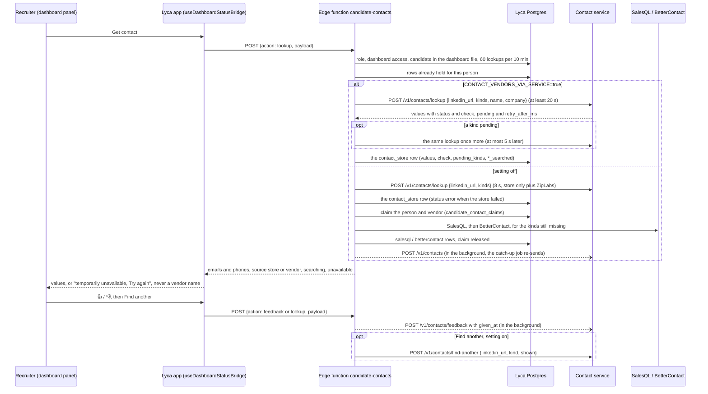

# Contact reveal (Lyca)

How Lyca finds a candidate's email and phone, what it keeps, and how it stays in step with the shared contact store. Lyca only: Adobe's project shares the code but has none of these tables or settings.

The code is in `supabase/functions/candidate-contacts/`, with the flow decisions in `flow.ts`. The catch-up job is `supabase/functions/contact-store-sync/`.

## What is live and what is in review (3 Nov 2026)

| State | What |
| --- | --- |
| **Live on Lyca production** (`main`, PRs #39/#40 and #43/#44) | "Get contact" asks the store (3 s, no `ziplabs: false`), then SalesQL, then BetterContact, both automatic; the vendors' answers and every 👍/👎 go to the store in the background; Find another after a 👎 goes to the next vendor not yet asked |
| **In review** | #46 (HIR-526): `store_synced_at` and the catch-up job. #47 (HIR-528): claims, one phone format, an 8 s store wait, `pending`, outages shown as such. #48 (HIR-537): `CONTACT_VENDORS_VIA_SERVICE`. This document describes the three together |
| **Not built** | Showing the service's email `check` in the panel (it is stored only); a rate limit on the panel's automatic re-check while the setting is on |

Whether the store's secrets are set on the Lyca project, and whether the catch-up job is scheduled, cannot be seen from the repo.

## The flow at a glance

## The reveal

**Who can do what:**
- "Get contact" is for Admins and Super Admins only, because it can spend vendor credits.
- Anyone who can see a dashboard can read its contacts and give a 👍/👎.

**A lookup only runs for a LinkedIn profile in that dashboard's own file.** Each person is limited to 60 vendor calls per 10 minutes.

"Get contact" asks, in this order, and stops at the first source that has a value for each kind (email, phone):

1. **Lyca's own rows.** A person looked up before is never bought again. Only kinds that still have no usable value are searched again: first in the store if it was never really asked for this person (it was down at the time, or the lookup predates it), then with a vendor that never answered for that kind.
2. **The shared contact store** at `CONTACT_ENRICHMENT_URL` (the contact-enrichment service). It holds what any HireSense platform has already revealed. If it has nothing usable, it asks ZipLabs on demand.
   - Lyca waits up to `CONTACT_ENRICHMENT_TIMEOUT_MS` (8 s by default), because a first ZipLabs answer takes several seconds.
   - **Still fetching.** The store may answer `pending` for a kind (ZipLabs is still fetching it) with `retry_after_ms`. Lyca then pays no vendor for that kind yet: it waits that long (at most 5 s), asks the store once more, and only what is still missing then goes to the vendors.
   - If the store is down, slow or answers with an error, Lyca goes on to its vendors. That is recorded (a `contact_store` row with status `error`), so a later "Get contact" asks the store again.
3. **SalesQL**, automatically, for each kind the store did not have.
4. **BetterContact**, automatically, for each kind SalesQL did not find.
   - BetterContact answers later. The panel checks back (a free status check, never a new charge).

**A vendor value its own vendor calls bad does not count as found.** That means a SalesQL email with status "Invalid", or a phone with `is_valid: false`. BetterContact is asked for that kind. Such a value is shown, marked "invalid by the source", only while nothing better exists.

**One paid call per person and vendor at a time.** Two recruiters, two tabs or a double click on the same person pay SalesQL once and BetterContact once:
- Before paying, the request claims the person and vendor in `candidate_contact_claims`, with an insert that does nothing if the row exists.
- The request that gets the row pays and saves the answer, then deletes the row.
- The others wait (up to 30 s) and show the saved answer.
- A claim older than 3 minutes was left by a request that died, and is taken over.

**Outage is not "no contact".** If the store or a vendor failed and nothing usable came back, the panel says the lookup is temporarily unavailable and offers "Try again". It never shows a final "No email found" in that case.

The dashboard only ever sees "Email" and "Phone", plus whether a value came from the store or from Lyca's own vendors. It is never told which vendor.

## 👍/👎 and "Find another"

**👍/👎 is offered on:**
- store values;
- SalesQL values, until BetterContact has been asked for that kind.

It is never offered on BetterContact values, because there is no vendor left to ask after them. Clicking the same thumb again clears it.

**"Find another email / number" is offered:**
- after a 👎 on a store value: the next vendor not yet asked for that kind (SalesQL, else BetterContact);
- after a 👎 on a SalesQL value: BetterContact, if not yet asked for that kind;
- as "Find email / number" for a kind with no value that a vendor never answered for, or that the store was never really asked for.

It is never offered after BetterContact. Each kind is bought from each vendor at most once per person.

"Find another", and resuming a person looked up before, **ask the store first** for the kinds wanted. A value the store has that is new for this person (not shown yet, not marked 👎) answers that kind without a paid vendor.

**One phone format for every comparison.** The rule is in `phone.ts`, exactly contact-enrichment's `docs/PHONE.md` (HireTap uses the same rule):
- India (+91) is the default country.
- `+91 98765 43210`, `098765 43210` and `9876543210` are one number.
- A result starting `+0` is not a phone, and a `+91` number is a phone only with 12 digits in all.
- **A value the rule refuses is not a phone at all** (for example SalesQL's `12345`, even with `is_valid: true`). It is not kept, not shown and not counted as found, so BetterContact is asked for a phone.

The comparisons that use it: de-duplication, "is this marked 👎", "is this new" for Find another, and which row a 👍/👎 belongs to. Rows keep the vendor's own text; only the comparisons use the shared format.

## Through the contact service (HIR-537)

Decision [HIR-461](https://linear.app/hiresenseai/issue/HIR-461): the shared contact service makes every contact vendor call. Lyca moves onto it behind one setting, `CONTACT_VENDORS_VIA_SERVICE` (a function secret on the Lyca project).

- **Off** (unset, the default, or anything but `true`): exactly the reveal above. Lyca asks the store, then calls SalesQL and BetterContact itself.
- **On** (`true`): Lyca calls no vendor itself. The code is `supabase/functions/candidate-contacts/via-service.ts`.

Lyca's vendor code stays, because switching back needs it. Turning the setting on or off is a secret change, not a code deploy.

**With the setting on:**

1. **"Get contact" is one `POST /v1/contacts/lookup`.**
   - It is sent without `ziplabs: false`, so the service runs Lyca's order from its `WATERFALLS`: the store, then SalesQL, BetterContact, and ZipLabs last.
   - It carries the candidate's `name` and `company` (what Lyca sends BetterContact today; left out when empty). The service gives them to BetterContact only and never stores them. Find another sends them too.
   - Lyca waits `CONTACT_ENRICHMENT_TIMEOUT_MS`, but never less than 20 s, because each vendor in the order can take its own timeout.
   - A kind in `pending` is waited for (`retry_after_ms`, at most 5 s) and asked once more. A kind still pending shows "Searching…", and the panel's automatic re-check asks the service again for that kind only.
   - A person looked up before is asked again only for kinds that are still pending, or that no source has answered (the last call failed, or Lyca's own vendors never ran for that kind before the switch).
2. **What the recruiter sees.**
   - The values the service returns whose `status` isn't `bad`, shown as today.
   - Each email keeps the service's email check (`check.result`: `valid`, `invalid` or `unknown`) in Lyca's row. Lyca runs no email check of its own and hides nothing because of it.
   - The service may go past an email that fails its check, so one answer can hold an invalid and a valid email. Both are shown. Each keeps its own `check` in the row, but the panel does not show the check yet (`flow.ts` does not pass it on), so the recruiter cannot tell them apart.
   - Every value takes 👍/👎, because after any 👎 the service can look further.
3. **"Find another" is `POST /v1/contacts/find-another`** with `{ linkedin_url, kind, shown }`, after a 👎. `shown` holds every value of that kind Lyca already shows.
   - `exhausted: true` means every source was asked, and the panel says "No other email / number found".
   - "Find email / number", for an empty kind no source answered, is a lookup for that kind.
4. **👍/👎** are saved in Lyca's table and reach the store (`POST /v1/contacts/feedback`), as before.
5. **Outages.** Any failure is "temporarily unavailable, try again". That covers a 503 (`vendors_unavailable` or `store_unavailable`), a timeout, a refused key, and a 409 `find_another_not_available` (Lyca missing from the service's `WATERFALLS`). Nothing final is recorded, and it is never "not found".
   - On "Get contact", the `contact_store` row records that the call failed (status `error` when it holds nothing).
   - On "Find another", nothing is written, and the request answers 503 with that message.
6. **Lyca's tables are as before.** The service's answer is the person's `contact_store` row in `candidate_contact_lookups`. While on, two of that row's columns have a meaning:
   - `email_searched` / `phone_searched`: every source was asked for that kind;
   - `pending_kinds`: the kinds the service was still fetching.

   Rows from Lyca's own vendors before the switch are kept and shown. Their values take 👍/👎, and "Find another" for them goes to the service.

**Switching on (in this order, or both pay):**

1. Set `CONTACT_VENDORS_VIA_SERVICE=true` on the Lyca project.
2. Add `lyca` to the service's `WATERFALLS` and redeploy the service: `lyca:salesql,bettercontact,ziplabs` once the service has BetterContact (`lyca:salesql,ziplabs` until then). Lyca's vendor keys then live in the service.

**Switching back:**

1. Remove `lyca` from the service's `WATERFALLS` and redeploy the service.
2. Set `CONTACT_VENDORS_VIA_SERVICE=false`, or unset it.

While the setting is off and `lyca` is still in `WATERFALLS`, the service's vendors and Lyca's own both run, and both pay.

**Known gap.** The service does not know which people Lyca's own vendors were asked about before the switch. A "Find another" for such a person can ask SalesQL again through the service.

## What is saved where

| Where | What |
| --- | --- |
| `candidate_contact_lookups` (Lyca's Supabase) | One row per person and source (`contact_store`, `salesql`, `bettercontact`): the emails and phones found, status, which kinds were searched. Service role only, no browser access. |
| `candidate_contact_feedback` (Lyca's Supabase) | One current 👍/👎 (with reason) per value. Service role only. |
| `candidate_contact_claims` (Lyca's Supabase) | A paid vendor call in progress: at most one per person and vendor, normally empty. Service role only. |
| The shared contact store | Every value SalesQL or BetterContact found, and every 👍/👎, so no HireSense platform pays for the same contact twice. Stored encrypted by the contact-enrichment service. |

## Keeping the store in step (HIR-526)

- **The live send.** Right after a row is saved, candidate-contacts sends it to the store in the background, so a reveal never waits on the store.
- **The mark.** Each row has `store_synced_at`:
  - Every write sets it back to empty.
  - A send that lands sets it, but only if the row is unchanged since the send (same `id` and `updated_at`).
  - A failed send leaves it empty.
- **The catch-up job.** `contact-store-sync` runs every 10 minutes (a pg_cron job on the Lyca project). It sends what is still empty, oldest first, lookups before 👍/👎, at most 200 rows and about 50 s per run.
  - It does nothing while the store's `GET /ready` is not 200.
  - It returns counts only. Logs never hold an email, phone or LinkedIn URL.
  - Rows from the store itself, and rows with no values, are marked without being sent.
  - A 👍/👎 waits (without using one of the 200 rows) while its contact's own row is not in the store yet, for at most 24 h.
- **`given_at`.** Every 👍/👎, live or from the job, carries `given_at`: the time it was saved.
  - The store ignores a verdict older than the one it holds, and ignores the same verdict sent twice, so re-sends are harmless.
  - A store from before `given_at` refuses the field. The verdict is then sent once more without it.

## Settings (function secrets on the Lyca project)

| Name | What |
| --- | --- |
| `CONTACT_ENRICHMENT_URL` | The contact-enrichment service. Unset: the store is skipped and the vendors run as before. |
| `CONTACT_ENRICHMENT_API_KEY` | Lyca's key for that service. |
| `CONTACT_ENRICHMENT_TIMEOUT_MS` | How long a reveal waits for the store (default **8000**; with `CONTACT_VENDORS_VIA_SERVICE` on, at least 20000). Keep 8000 on Lyca prod before ZipLabs on demand goes live on the store. Background saves and 👍/👎 have their own 3 s timeout. |
| `CONTACT_STORE_SYNC_SECRET` | The catch-up job's own key: the cron job sends it as header `x-contact-store-sync-secret`. While unset, `contact-store-sync` refuses every call. The cron job reads it from Supabase Vault. |
| `CONTACT_VENDORS_VIA_SERVICE` | `true`: every vendor call goes through the contact service (HIR-537, above). Unset or anything else: Lyca's own vendors, as before. |
| `SALESQL_API_KEY`, `BETTERCONTACT_API_KEY` | The vendors. Unset: that vendor is skipped. |
| `SALESQL_API_URL`, `BETTERCONTACT_API_URL` | Local tests against a fake vendor only. Never set them on a hosted project. |

A store answer of 401 or 403 means Lyca's key is wrong or revoked. It is logged as an error, not a warning.

Locally these go in `supabase/functions/.env`, which is gitignored. Never commit a value.

## Going live

Migrations and functions reach the Lyca project only through `scripts/lyca-deploy.mjs` (see [ENVIRONMENTS.md](ENVIRONMENTS.md)).

**Always migrations before functions.** For example, `20261029000002_contact_lookup_claims.sql` must be applied before the `candidate-contacts` that uses the claims. Without the table, every paid lookup fails instead of paying.

The catch-up job needs one more step: a secret and a schedule that must not live in git. The user does this with a go-live script kept outside the repo (`qa-runs/2026-10-29/lyca-store-sync/lyca-store-sync-go-live.ps1`, with its own README). It:
- applies the migration;
- deploys both functions;
- sets a new random `CONTACT_STORE_SYNC_SECRET` and stores it with the function URL in Vault;
- schedules the job;
- fails unless the job's own call answers HTTP 200.
